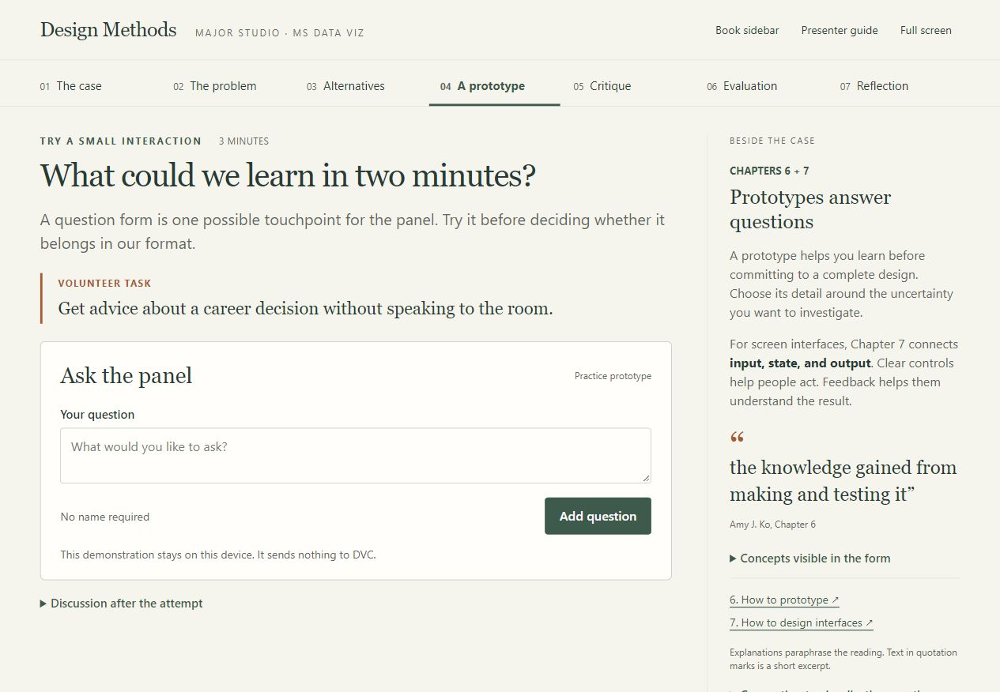

# Design Methods in Practice: DVC Career Panel

A 15-minute interactive reading presentation for **Major Studio · MS Data Viz**, applying Amy J. Ko’s *Design Methods* to the design of DVC’s first career panel.

**[Open the live presentation](https://dvc-design-methods-lab-haolong.hihaolong.chatgpt.site/)** · **[Read the English / 中文 presenter guide](docs/presenter-guide-en-zh.txt)** · **[Read the book](https://faculty.washington.edu/ajko/books/design-methods/)**



## For the reviewer

Open the live presentation and move through the seven tabs. The main column contains the case, decisions, activities, and discussion prompts; the sidebar connects them to the reading. Press **G** to open the presenter guide, which includes an English / 中文 switch.

For a quick review, choose a working need in **The problem**, choose a format in **Alternatives**, try the question form in **A prototype**, answer the **Evaluation** question, and open **Reflection** to see how the recorded decisions carry through the presentation. The full classroom sequence is designed for 15 minutes.

The repository contains the complete app source and presenter guide. It can also be run locally without an account, installation, or build step.

## Presentation concept

The audience learns the reading through a shared design exercise. Classmates make provisional decisions, explain their reasoning, try a small interaction, and question the evidence behind their choices. The presenter records the room’s decisions on one shared screen.

The purpose is to demonstrate and discuss design methods. A finished event plan is not an expected outcome. The proposed attendee needs are hypotheses for investigation, and classroom votes are not evidence of the broader DVC audience’s needs.

For MS Data Viz, the activities connect to defining an audience, distinguishing assumptions from evidence, exploring alternative representations and interactions, communicating state and feedback, and evaluating whether a design supports its intended task.

## Reading and activity map

| Section | Book chapters | Classroom activity | Time |
| --- | --- | --- | --- |
| The case | 1–2: What designers do; How to design | Share an initial idea of what makes a career panel worthwhile. | 1 min |
| The problem | 3–4: How to understand problems; How to define problems | Select a need to investigate, identify the people involved, and discuss supporting or challenging evidence. | 3 min |
| Alternatives | 5: How to be creative | Generate and compare possible panel formats; explain a provisional choice. | 2 min |
| A prototype | 6–7: How to prototype; How to design interfaces | Try a question-submission prototype and discuss input, state, and feedback. | 3 min |
| Critique | 8: How to be critical | Give a reasoned critique tied to people, goals, and design choices. | 2 min |
| Evaluation | 9–10: How to evaluate empirically; How to evaluate analytically | Distinguish observation, analytical inspection, and critique; identify further evidence needed. | 2 min |
| Reflection | Across the book | Revisit the decisions and name a method to use in a future visualization project. | 2 min |

This is a selective application across all ten chapters. Each chapter contains more depth than the short session can cover.

## How to present

- Use the tabs, Previous / Next buttons, or **← / →** to navigate.
- Press **G** to open or close the presenter guide; **Esc** closes it. Shortcuts stay inactive while typing.
- Switch between **English / 中文** inside the guide. The presentation itself is in English.
- Toggle the book sidebar when moving between discussion and the reading.
- Use a show of hands for the first two choice activities, then record the room’s provisional choice. Custom answers are supported.
- In the prototype, invite one volunteer to enter a career question without explaining which button to press. Observe what they do and ask what they think happened.
- In Reflection, download the class notes if useful. **Start a fresh session** clears this browser’s saved choices and notes after confirmation.

The presenter guide appears on the shared presentation screen; it is not a separate private speaker view.

## Run locally

1. Download the repository using **Code → Download ZIP** and extract it, or clone it with Git.
2. Open **index.html** in a current browser. Keep `app.js` and `style.css` in the same folder.

No package installation or build is required. If your browser restricts saving from local files, use a local static server or the live link above. The activities work offline; following the book links requires internet access.

## Files

```text
index.html                       App shell and navigation containers
style.css                        Responsive layout and visual styling
app.js                           Activities, chapter references, state, and bilingual guide
README.md                        Submission overview and review instructions
docs/presenter-guide-en-zh.txt    Complete English and Chinese presenter guide
docs/presentation-preview.png    Opening-screen preview
```

## Data and prototype scope

Choices, notes, and the guide language are stored in this browser’s local storage. The app has no backend, login, analytics, or shared voting service. The presenter records group choices manually.

The anonymous-question interaction is a **local simulation**. It does not send a question to DVC or a moderator, and it does not provide career advice. Class notes are exported as a Markdown file on the reviewer’s device. No classroom responses or research findings are bundled with this submission.

## Source and credits

The reading is Amy J. Ko’s [*Design Methods*, 2nd edition](https://faculty.washington.edu/ajko/books/design-methods/). Chapter links and short attributed excerpts appear alongside the activities. The book retains its own license and copyright; this repository does not reproduce the full text.

The DVC case activities and prototype are applications of the reading created for this presentation, not examples supplied by the book. AI assistance was used in developing the app, structuring the presentation, and drafting the bilingual presenter guide.
